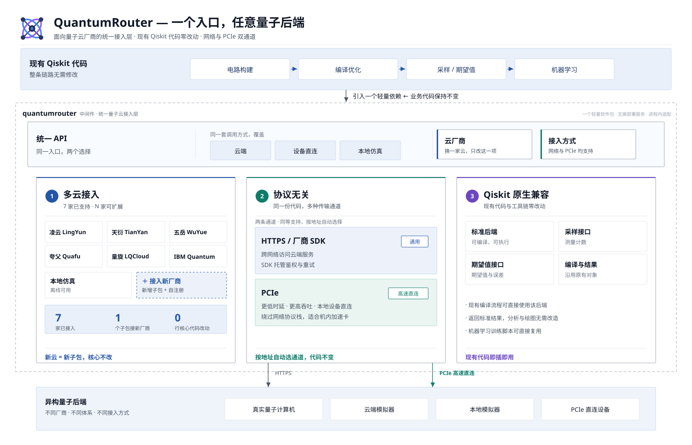

<p align="center">
  
</p>

<h1 align="center">QuantumRouter</h1>

<p align="center">
面向量子云厂商的统一接入层。一个入口，任意量子后端。
</p>

<p align="center">
  <a href="https://pypi.org/project/quantumrouter/">
    
  </a>
  <a href="https://www.python.org/downloads/">
    
  </a>
  <a href="https://pypi.org/project/quantumrouter/">
    
  </a>
  <a href="https://github.com/yaqiangsun/QuantumRouter/issues">
    
  </a>
  <a href="https://github.com/yaqiangsun/QuantumRouter/commits/main">
    
  </a>
  <a href="LICENSE">
    
  </a>
  
  <br>
  <a href="#安装">安装</a> •
  <a href="#快速开始">快速开始</a> •
  <a href="#示例">示例</a> •
  <a href="#添加厂商">添加厂商</a> •
  <a href="#许可证">许可证</a>
  <br>
  <a href="README.md">English</a> · <b>简体中文</b>
</p>

## 简介

QuantumRouter 是一个 Python 库，为多家量子云厂商提供**统一接口**。从一家厂商
（凌云、IBM Quantum、天衍、五岳……）切换到另一家只需改一行参数——调用代码保持
完全不变。

库对外暴露与厂商无关的 `Provider` / `Backend` / `Transport` 抽象。每个具体厂商位于
`quantumrouter/providers/<vendor>/`，在导入时自注册到进程级注册表。厂商子包按需
**懒加载**，因此安装一家厂商不会强迫你安装其他厂商的依赖。

## 安装

### 从 PyPI 安装（推荐）

```bash
pip install quantumrouter
```

这会安装核心包及其基础依赖（`qiskit`、`requests`）。厂商专属的第三方依赖**不会**
默认安装，按需安装对应的 extras：

```bash
pip install "quantumrouter[lingyun]"   # 仅凌云依赖（numpy）
pip install "quantumrouter[ibm]"       # IBM Quantum 依赖（qiskit-ibm-provider）
pip install "quantumrouter[tianyan]"   # 天衍依赖（cqlib-adapter）
pip install "quantumrouter[wuyue]"     # 五岳依赖（无——直连 REST）

pip install "quantumrouter[all]"       # 一次装齐所有厂商依赖
```

多个 extras 可以组合，例如 `pip install "quantumrouter[lingyun,ibm]"`。

> **注意**——给 extras 参数加上引号（`"quantumrouter[all]"`），避免 shell 把方括号
> 当成通配符解析。

## 快速开始

```python
import quantumrouter

provider = quantumrouter.create_provider(
    backend="lingyun",                   # 改这里即可切换厂商
    url="http://xx.xxxx.xx:8000",        # 云端 / 仿真服务地址
    token="...",                         # 仿真服务可为空
)

backends = provider.backends(online=True)
backend = backends[0]

task_ids = backend.submit_job(["QINIT 4\nH 0"], shots=1024)
results  = backend.query_job(task_ids)
config   = backend.fetch_configuration()
```

用 `backend.run(...)` 代替 `submit_job(...)`：用 qiskit 构建线路、执行，并一次取回
`Result` 对象（含测量计数），见 `examples/basic_usage.py`。

当 URL scheme 为 `pcie://` 时，同一个入口会选择 **PCIe 传输**——调用代码不变：

```python
provider = quantumrouter.create_provider(
    backend="lingyun",
    url="pcie:///dev/quantum0",
)
```

## 示例

`examples/` 目录包含可直接运行的厂商示例：

| 示例 | 厂商 | 说明 |
|---|---|---|
| [basic_usage.py](examples/basic_usage.py) | 本地 / 凌云 / 天衍 / 五岳 / 夸父 / 量旋 | 合并演示——同一份代码，用 `--backend` 切换厂商（`--backend local` 跑在 Qiskit 自带模拟器上，无需云账号） |
| [multi_vendor.py](examples/multi_vendor.py) | 凌云 + IBM | 用一个参数切换厂商 |
| [pcie_transport.py](examples/pcie_transport.py) | 凌云 | 通过 URL scheme 选择 PCIe 传输 |
| [nn/sampler_train.py](examples/nn/sampler_train.py) | 本地 / 凌云 / 天衍 / 五岳 / 夸父 / 量旋 | 通过 `quantumrouter.Sampler` 训练 `SamplerQNN`——用 `--backend` 切换厂商（`--backend local` 完全离线） |

运行任意示例，例如：

```bash
python examples/basic_usage.py
```

多数示例从环境变量读取连接信息（`LINGYUN_TOKEN`、`LINGYUN_URL`、
`IBM_QUANTUM_TOKEN` 等），运行前按需设置。`--backend local` 一个都不需要：它跑在
Qiskit 自带模拟器（`quantumrouter.providers.local`）上，无需云账号即可体验全部
API。

`nn/` 下的示例额外需要 `qiskit-machine-learning`
（`pip install qiskit-machine-learning`）。

## 架构



```
quantumrouter/
├── transport/                  # 通用传输层（HTTP、PCIe……）
├── backend/                    # 通用后端契约
├── provider/                   # Provider 抽象基类 + 注册表 + 工厂
└── providers/                  # 每个云厂商一个子包
    ├── base.py / registry.py   #   共享抽象 + 注册表
    ├── __init__.py             #   懒加载厂商子包的 __getattr__
    ├── ibm/                    #   IBM Quantum（qiskit-ibm-provider）
    ├── lingyun/                #   凌云 —— HTTP / PCIe，QCIS & OpenQASM3
    ├── lqcloud/                #   量旋 —— REST，自有指令 IR
    ├── local/                  #   本地 Qiskit 模拟器（无网络）
    ├── quafu/                  #   夸父 —— REST，OpenQASM 2
    ├── tianyan/                #   天衍 —— cqlib-adapter
    └── wuyue/                  #   五岳 —— REST + AK/SK 请求签名
```

自上而下的三层：

- **Transport**（`transport/`）——负责字节收发。HTTP 与 PCIe 实现在同一套
  `Transport` 接口之后。
- **Backend**（`backend/`）——封装一台量子计算机或模拟器，暴露用户真正关心的
  操作：列出、提交、查询、获取校准数据。
- **Provider**（`provider/`）——每家厂商的入口。由 `ConnectionConfig` 构建传输，
  交给传输支撑的 client，并列出后端。

单一工厂 `create_provider(backend=..., url=..., token=...)` 把各层串起来；传输类型
（HTTP 或 PCIe）由 `ConnectionConfig.from_url()` 从 URL scheme 推断。

## 添加厂商

1. 创建 `quantumrouter/providers/<vendor>/`，包含：
   - `provider.py` —— `Provider` 子类，实现 `backends()` 与 `backend(name)`，
     并在导入时通过 `ProviderRegistry.register(<YourProvider>)` 自注册。
   - `client.py` —— 面向该厂商 REST 接口、由传输层支撑的 API client。
   - `backend/` —— `Backend` 子类，把通用契约绑定到该厂商的响应格式。
2. 把厂商 id 加入 `quantumrouter/providers/__init__.py` 的 `_VENDOR_PACKAGES`，
   让懒加载的 `__getattr__` 能找到它。
3. 在 `pyproject.toml` 中增加可选依赖组（如 `[<vendor>]`）用于该厂商的第三方
   依赖，并把它加入 `[all]` 聚合。

厂商包在被导入时即完成自注册，注册表会在首次调用
`create_provider("<vendor>", ...)` 时自动触发导入。只安装你需要的厂商即可，其余
厂商保持未加载。

## 许可证

[LICENSE](LICENSE)
